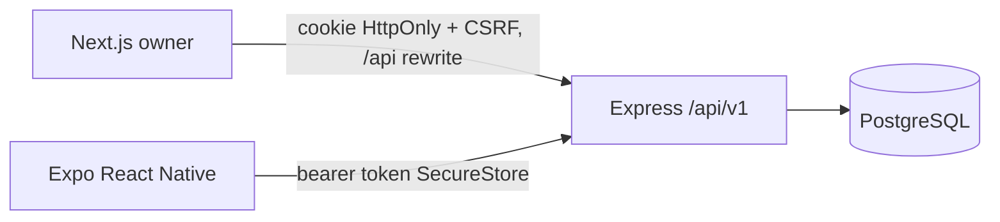

# Arsitektur yang disepakati

Keputusan pengguna: satu monorepo dengan Next.js owner, Expo kasir, dan Express API pada folder aplikasi terpisah. Ini menggantikan usulan API Next.js/pnpm pada PRD awal. npm workspaces menjaga kelanjutan proyek awal.

Kasir menggunakan Expo SDK 58.0.25 / React Native 0.88.1. React 19.3.0 dipakai bersama dashboard Next.js; overrides root menyelaraskan React dan paket native inti agar dependency peer tidak menginstal runtime versi lama. Paket native lain mengikuti versi yang direkomendasikan SDK 58. NativeWind tetap pada rilis stabil 4.2.7 dengan Tailwind 3, sedangkan dashboard memakai Tailwind 4.

Komponen native lokal memakai font Host Grotesk yang dibundel lewat `expo-font` (empat bobot statis dari aset dashboard, lisensi OFL disertakan). `components/motion.tsx` memakai Reanimated untuk respons tekan 120 ms dan kemunculan item; dialog memiliki fade/transform 220 ms saat masuk dan 160 ms saat keluar, dengan konten dipertahankan sampai exit selesai. Pengaturan reduced motion meniadakan skala/pergeseran. Haptik hanya dipicu saat item berhasil ditambahkan dan transaksi berhasil dicatat; kegagalan haptik tidak menghambat transaksi.

Express memegang otorisasi, harga, stok, biaya, transaksi dan laporan. `packages/db` tidak boleh diimpor client. DTO publik kasir disusun eksplisit sehingga tidak membawa biaya, resep internal, hash password atau laporan laba. Kontrak Zod dan token visual dibagi; UI web/native berbeda.

Select kategori/isian memakai `@rn-primitives/select` dan portal milik masing-masing `ModalFrame`. Menu native diposisikan di atas dialog yang sama; implementasi web memakai primitive Radix melalui paket tersebut. Nama/harga ditata terpisah, pilihan aktif memiliki indikator, dan isian tetap wajib dipilih. Tombol Back/Escape menutup daftar terlebih dahulu. Picker sistem sementara telah dihapus dari dependency; versi final memakai komponen React Native dengan tampilan bersama.

## Database dan konsistensi

Migrasi SQL merupakan sumber DDL yang diaudit. Drizzle mendefinisikan model inti dan dipakai pada pembacaan autentikasi; transaksi stok/uang memakai query PostgreSQL eksplisit melalui pool agar row lock dan urutan posting jelas. Migrasi memiliki advisory lock dan tabel versi.

Entitas: bisnis, cabang, user/penugasan/sesi, produk/SKU/modifier, item/saldo stok, resep SKU/topping per cabang, shift, order/payment/refund, expenses, cash movements, stock ledger, audit, requests, idempotency. Ledger stok dan audit menolak update/delete lewat trigger. Koreksi diposting sebagai kejadian baru.

Qty/nilai buku disimpan sebagai PostgreSQL numeric dan dihitung Decimal saat posting. Kuantitas resep memakai string decimal di kontrak; uang jual IDR adalah integer terbatas. Biaya historis dan resep disnapshot pada order. Nilai persediaan memakai moving average, produksi mengalokasikan nilai input ke hasil aktual, transfer membawa nilai buku, refund memulihkan biaya keluar asli bila dipilih.

Checkout mengunci sesi/akun, shift, katalog/resep dan saldo yang diperlukan. Penguncian stok diurutkan konsisten. Idempotency key terikat aktor, operasi dan hash payload; payload berbeda ditolak. Hasil disimpan dalam commit yang sama. Konflik deadlock/serialization diulang terbatas.

## Keamanan sesi

Username dinormalisasi lowercase dan unik. Password Argon2id. Token opaque acak disimpan sebagai hash pada server, berlaku 12 jam, dapat dicabut. Web memakai cookie HttpOnly/SameSite dan CSRF token. Origin write dibatasi. Native memakai bearer token dan SecureStore; mode web Expo memakai memori. Login memiliki rate limit.

Edit staf oleh owner mencabut seluruh sesi akun tersebut, termasuk edit username/password. Akun nonaktif ditolak pada login dan setiap request. Penugasan dan shift divalidasi ulang di operasi kritis; ID cabang client bukan otorisasi. Tidak ada pemilihan role yang dipercaya dari client.

## Perubahan menu dibanding PRD contoh

Kategori Gurih pedas/Manis, ukuran Small/Medium/Jumbo, isian serta harga per SKU. Panir tetap dasar. Kentang/Mie berada pada kelompok EXTRA, bukan alternatif lapisan. Topping gratis tetap dapat memakai bahan stok. Asumsi menu lain pada README mengikuti buku menu pengguna, bukan contoh Regular/Large PRD lama.

## Batas render kasir Expo

- `CustomizeDialog` memiliki state kategori, isian, topping, jumlah, dan catatan sendiri. Sesi dialog baru memakai key baru agar pilihan awal selalu kosong. Layar kasir menerima `CartLine` lengkap saat ditambahkan, dengan pemeriksaan jumlah kumulatif terhadap ketersediaan SKU.
- `SizeMenu` dan `CartPanel` memakai memo dengan callback stabil; perhitungan pilihan per ukuran di-cache berdasarkan katalog. Ilustrasi corndog juga memakai memo.
- Antrean/riwayat memakai satu `FlatList` sebagai pemilik scroll, dengan `OrderCard` memo. Daftar virtual tidak diletakkan dalam `ScrollView` vertikal lain. Tinggi baris tetap mengikuti isi pesanan dan ukuran teks.
- Dropdown native memakai `FlatList` ketika jumlah opsi melebihi 30. Opsi pendek dan versi web mempertahankan perilaku select semula, termasuk navigasi keyboard Radix pada web.
- Polling 20 detik ditetapkan secara eksplisit untuk shift, katalog, stok, dan antrean. Riwayat diperbarui saat dibuka/fokus kembali atau query di-invalidasi sesudah perubahan transaksi; riwayat tidak memakai polling berkala.

## Lingkungan

- Web 3000, Express 4000, Metro 8081, PostgreSQL loopback 5432.
- Web proxy API menjaga autentikasi cookie satu origin. Akses tablet memakai URL LAN API; deployment membutuhkan HTTPS.
- `.env` dan `.env.local` diabaikan Git. File contoh hanya kredensial review lokal, bukan secret produksi.
- Tidak ada publikasi, pembuatan akun eksternal, atau layanan berbayar.

## Pelaporan owner dan histori terbatas

`GET /reports/overview` mengembalikan KPI, deret harian, produk/ukuran, topping, metode pembayaran, kontribusi cabang dan empat transaksi terbaru. Agregasi dilakukan PostgreSQL di dalam transaksi repeatable-read/read-only. Kejadian penjualan memakai waktu order; refund memakai waktu refund aktual. Qty terjual dan qty direfund disajikan terpisah. Angka produk mencakup harga jual snapshot per porsi; topping dilaporkan sebagai jumlah pilihan karena harga individual modifier belum disnapshot terpisah pada histori lama.

`GET /owner/orders` memakai filter cabang/periode/metode/search yang sama dengan ekspor transaksi dan cursor nomor order menurun, default 25/maksimal 100. `GET /owner/orders/:id` mengambil detail lama ketika dibuka dari notifikasi. Proyeksi `/owner/state` dibatasi pada 25 transaksi terbaru; dashboard tidak memakai daftar pendek itu sebagai dasar total. Migrasi `0002_owner_reporting_indexes.sql` menambah indeks business/waktu, business/nomor dan waktu refund.

Website mempertahankan angka terakhir pada refresh filter yang sama, menampilkan tanda kosong saat filter baru belum selesai, dan menyediakan error/retry. Waktu pembaruan laporan berasal dari respons laporan yang berhasil, terpisah dari waktu refresh owner-state. Grafik memakai shadcn Chart + Recharts 3.10.1: area/garis dengan tinggi eksplisit, domain positif/negatif, garis nol, tooltip dan tabel data harian. Accessibility layer Recharts mendukung navigasi keyboard. Periode cepat mencakup hari ini, kemarin, tujuh hari, bulan ini, dan rentang kustom. Grafik mempertahankan cakupan maksimal tujuh hari terakhir yang dijelaskan pada kartunya; KPI dan rincian memakai seluruh rentang.

## Batas render dan pemuatan owner Next.js

- Shell login memuat App melalui `next/dynamic` setelah sesi owner siap. Chart/Recharts, halaman inventori, histori owner dan rincian laporan mempunyai batas dynamic import tersendiri. Manifest produksi memisahkan chunk chart, inventory-page/tools, owner-history dan report-breakdowns dari chunk App.
- CatalogPage dan InventoryPage memegang state pencarian/tab lokal, memakai deferred search dan memo dengan callback stabil. ProductFields memegang kategori form lokal; koreksi pengeluaran dan penutupan shift memiliki dialog/state sendiri. Ilustrasi corndog dan chart menggunakan memo. Hasil overview yang identik memakai structural sharing agar array/props chart tidak berubah hanya karena polling.
- Katalog, tabel stok, mutasi, daftar resep, staf dan rincian produk/topping membatasi DOM per halaman melalui PaginatedList, default 25. Ini membatasi render; data operasional stok/katalog tetap tersedia untuk perhitungan dan pemilihan item. Ekspor rincian laporan tetap memakai seluruh hasil agregat pada filter, bukan hanya halaman tabel yang terlihat.
- InventoryToolsShell berada pada aksi kanan atas judul halaman stok dan memuat implementasi alat setelah tombol pertama kali dipakai. Tambah bahan, Atur resep, Batas stok minimum dan Posting produksi membuka dialog terpisah dengan Scroll Area. Controller alat tetap terpasang ketika dialog ditutup; draft dikontrol state sehingga input bertahan walaupun DOM form dilepas. Query aktif hanya untuk alat yang dibuka; katalog/resep modifier hanya aktif pada target modifier. Pilihan cabang minimum stok terpisah dari cabang resep. Tombol Catat produksi di tab Produksi membuka dialog produksi yang sama melalui handle controller; tidak lagi hanya menampilkan petunjuk.
- `/owner/state` hanya membawa shift aktif untuk penugasan/guard operasional dan tidak lagi membawa histori pengeluaran. `/owner/shifts` memakai filter cabang/status dan `/owner/expenses` memakai cabang/periode, masing-masing cursor pagination default 25/maksimal 100. Cursor menyimpan timestamp UTC presisi mikrodetik dan identitas baris untuk urutan stabil pada waktu yang sama.
- Pengeluaran dan reversal diproyeksikan sebagai kejadian terpisah pada tanggalnya masing-masing. KPI jumlah/kategori pengeluaran berasal dari agregasi server expenseStats. Koreksi memakai originalId serta kunci idempotensi yang dipertahankan pada retry. Migrasi 0003 menambah indeks histori pengeluaran/shift.
- Transisi primitive tab menyebut properti eksplisit. Sidebar tidak diubah dalam optimasi ini: clip-path masih memerlukan recording layer/paint sebelum diputuskan perlu diganti.

## Konfirmasi dan aksi owner

`ConfirmationProvider` berada di luar `OwnerWorkspace`; callback context stabil sehingga pembukaan, pending, error dan penutupan AlertDialog tidak merender ulang parent halaman. `StatusActionButton` digunakan katalog, cabang dan staf dengan salinan dampak masing-masing. Guard shift aktif tetap dijalankan sebelum membuka konfirmasi, dan validasi server tetap menjadi otoritas saat penyimpanan.

Dialog menunggu promise aksi, mencegah eksekusi ganda dan dismissal saat pending, mempertahankan error untuk retry, dan memulihkan fokus ke pemicu yang masih terpasang. Konten terakhir dipertahankan selama animasi keluar agar teks tidak menghilang mendadak. Form operasional yang telah memiliki dialog review tetap menggunakan alur tersebut, tanpa menumpuk dialog konfirmasi tambahan.
